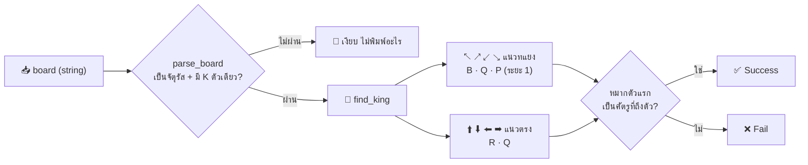

<div align="center">



<br/>

<a href="#press-start"><kbd>🎮 PRESS START</kbd></a>&nbsp;
<a href="#world-map"><kbd>🗺️ WORLD MAP</kbd></a>&nbsp;
<a href="#quest-log"><kbd>📜 QUEST LOG</kbd></a>&nbsp;
<a href="#boss-fight"><kbd>👑 BOSS FIGHT</kbd></a>&nbsp;
<a href="#player-stats"><kbd>🧙 STATS</kbd></a>&nbsp;
<a href="#how-to-play"><kbd>🕹️ HOW TO PLAY</kbd></a>


</div>

<a id="press-start"></a>

## 🎮 PRESS START

> **Piscine** (ปิ-ซีน) แปลว่า *"สระว่ายน้ำ"* ในภาษาฝรั่งเศส
> เพราะที่ 42 ทุกคนต้องกระโดดลงน้ำลึกตั้งแต่วันแรก แล้วค่อย ๆ หัดว่ายไปพร้อมกับเพื่อน ๆ 🏊

ยินดีต้อนรับสู่ **สมุดบันทึกการผจญภัย** ใน **Discovery Piscine @ 42 Bangkok** 🐍<br/>
repo นี้เก็บทุกด่านตั้งแต่ `print(42)` บรรทัดแรก ผ่านตัวแปร เงื่อนไข ลูป สตริง และ list
ไปจนถึงบอสใหญ่ **RUSH : Checkmate** ♛<br/>
ไม่มีห่วงยาง มีแค่ Python, Terminal และความตั้งใจ ✨

<div align="center">
  
</div>

<a id="world-map"></a>

## 🗺️ WORLD MAP

<div align="center">
  
</div>

<div align="center">

| ด่าน | ชื่อด่าน | สกิลที่ได้ | Quests |
|:---:|---|---|:---:|
| 🛟 `cell00` | **First Splash** | `print` และ repo แรก | 3 |
| 🛟 `cell01` | **Variable Village** | ตัวแปร, `input()`, f-string | 4 |
| 🛟 `cell02` | **If/Else Crossroads** | `if` / `elif` / `else` | 4 |
| 🛟 `cell03` | **Loop Lagoon** | `while`, `for`, ลูปซ้อนลูป | 4 |
| 🛟 `cell04` | **String Forge** | เมธอดของ `str`, `float`, `math` | 6 |
| 🛟 `cell05` | **Array Archipelago** | `list`, `set`, `sys.argv` | 15 |
| 👑 `RUSH` | **Checkmate Castle** | กระดาน 2 มิติ, ฟังก์ชัน, อัลกอริทึม | **BOSS** |

</div>

<a id="quest-log"></a>

## 📜 QUEST LOG

<sub>👇 กดที่แต่ละด่านเพื่อเปิดดู quest ทั้งหมด</sub>

<details>
<summary><b>🌊 CELL 00 · First Splash</b> &nbsp;<code>3 quests</code></summary>
<br/>

| # | Quest | ภารกิจ |
|:-:|---|---|
| ex00 | [`.gitkeep`](cell00/ex00/.gitkeep) | ปักธงโฟลเดอร์แรกใน repo 🚩 |
| ex01 | [`42.py`](cell00/ex01/42.py) | พิมพ์เลขศักดิ์สิทธิ์ `42` |
| ex02 | [`hello_world.py`](cell00/ex02/hello_world.py) | `Hello World` คลาสสิกตลอดกาล 👋 |

```console
$ python3 cell00/ex01/42.py
42
```

</details>

<details>
<summary><b>🏘️ CELL 01 · Variable Village</b> &nbsp;<code>4 quests</code></summary>
<br/>

| # | Quest | ภารกิจ |
|:-:|---|---|
| ex00 | [`name.py`](cell01/ex00/name.py) | เก็บชื่อ-นามสกุลไว้ในตัวแปรแล้วพิมพ์ออกมา |
| ex01 | [`name.py`](cell01/ex01/name.py) | กำหนดหลายตัวแปรในบรรทัดเดียว แล้วสลับลำดับ |
| ex02 | [`age.py`](cell01/ex02/age.py) | เอาตัวเลขในตัวแปรมาบวกกัน |
| ex03 | [`whatsyourname.py`](cell01/ex03/whatsyourname.py) | ใช้ `input()` ถามชื่อแล้วทักทายด้วย f-string |

```console
$ python3 cell01/ex03/whatsyourname.py
Hey, what's your first name? : Pixel
And your last name? : Cadet
Well, pleased to meet you, Pixel Cadet.
```

</details>

<details>
<summary><b>🔀 CELL 02 · If/Else Crossroads</b> &nbsp;<code>4 quests</code></summary>
<br/>

| # | Quest | ภารกิจ |
|:-:|---|---|
| ex00 | [`iszero.py`](cell02/ex00/%20iszero.py) | เลขนี้เป็นศูนย์หรือเปล่า? |
| ex01 | [`isneg.py`](cell02/ex01/%20isneg.py) | บวก ลบ หรือศูนย์ |
| ex02 | [`password.py`](cell02/ex02/%20password.py) | ใส่รหัสผ่านให้ถูก → `ACCESS GRANTED` 🔐 |
| ex03 | [`mult.py`](cell02/ex03/mult.py) | คูณสองจำนวน แล้วบอกว่าผลเป็นบวกหรือลบ |

```console
$ python3 "cell02/ex02/ password.py"
Python is awesome
ACCESS GRANTED
```

</details>

<details>
<summary><b>🔁 CELL 03 · Loop Lagoon</b> &nbsp;<code>4 quests</code></summary>
<br/>

| # | Quest | ภารกิจ |
|:-:|---|---|
| ex00 | [`to25.py`](cell03/ex00/to25.py) | ใช้ `while` นับขึ้นไปจนถึง 25 |
| ex01 | [`multiplication_table.py`](cell03/ex01/multiplication_table.py) | สูตรคูณแม่เดียวด้วย `for` |
| ex02 | [`i_got_that.py`](cell03/ex02/%20i_got_that.py) | วนรับข้อความไปเรื่อย ๆ จนกว่าจะพิมพ์ `STOP` 🛑 |
| ex03 | [`advanced_mult.py`](cell03/ex03/advanced_mult.py) | ตารางสูตรคูณ 0–10 ด้วยลูปซ้อนลูป |

```console
$ python3 "cell03/ex02/ i_got_that.py"
What you gotta say? : สวัสดี 42
I got that! Anything else? : ว่ายน้ำเป็นแล้ว
I got that! Anything else? : STOP
```

</details>

<details>
<summary><b>⚒️ CELL 04 · String Forge</b> &nbsp;<code>6 quests</code></summary>
<br/>

| # | Quest | ภารกิจ |
|:-:|---|---|
| ex00 | [`upcase_it.py`](cell04/ex00/upcase_it.py) | แปลงคำเป็นตัวพิมพ์ใหญ่ |
| ex01 | [`age.py`](cell04/ex01/age.py) | อีก 10 / 20 / 30 ปีจะอายุเท่าไหร่ ⏳ |
| ex02 | [`calculator.py`](cell04/ex02/calculator.py) | เครื่องคิดเลข บวก ลบ หาร คูณ |
| ex03 | [`float.py`](cell04/ex03/float.py) | จำนวนเต็มหรือทศนิยม? |
| ex04 | [`round_up.py`](cell04/ex04/round_up.py) | ปัดขึ้นด้วย `math.ceil` |
| ex05 | [`up_low.py`](cell04/ex05/up_low.py) | สลับตัวพิมพ์เล็ก ↔ ใหญ่ทีละตัวอักษร |

```console
$ echo "PiXeL ArT 42" | python3 cell04/ex05/up_low.py
pIxEl aRt 42
```

</details>

<details>
<summary><b>🏝️ CELL 05 · Array Archipelago</b> &nbsp;<code>15 quests</code></summary>
<br/>

| # | Quest | ภารกิจ |
|:-:|---|---|
| ex00 | [`create_array.py`](cell05/ex00/create_array.py) | สร้าง list แรกในชีวิต |
| ex01 | [`play_with_arrays.py`](cell05/ex01/play_with_arrays.py) | บวก 2 ทุกตัวด้วย list comprehension |
| ex02 | [`play_with_arrays.py`](cell05/ex02/play_with_arrays.py) | เลือกเฉพาะตัวที่มากกว่า 5 แล้วบวก 2 |
| ex03 | [`play_with_arrays.py`](cell05/ex03/play_with_arrays.py) | แบบเดิม แต่ตัดตัวซ้ำด้วย `set` |
| ex04 | [`parameters.py`](cell05/ex04/parameters.py) | นับจำนวน argument |
| ex05 | [`aff_first_param.py`](cell05/ex05/aff_first_param.py) | พิมพ์ argument ตัวแรก |
| ex06 | [`upcase_it.py`](cell05/ex06/%20upcase_it.py) | argument → ตัวพิมพ์ใหญ่ |
| ex07 | [`downcase_it.py`](cell05/ex07/%20downcase_it.py) | argument → ตัวพิมพ์เล็ก |
| ex08 | [`aff_rev_params.py`](cell05/ex08/aff_rev_params.py) | พิมพ์ argument ย้อนหลัง ⏪ |
| ex09 | [`scan_it.py`](cell05/ex09/scan_it.py) | นับว่าคำหนึ่งโผล่ในข้อความกี่ครั้ง |
| ex10 | [`parameter_matching.py`](cell05/ex10/parameter_matching.py) | เกมทายว่า argument คืออะไร 🎯 |
| ex11 | [`count_it.py`](cell05/ex11/count_it.py) | นับความยาวของแต่ละคำ |
| ex12 | [`string_are_arrays.py`](cell05/ex12/string_are_arrays.py) | ล่าหาตัว `z` แล้วพิมพ์ `z` ตามจำนวนที่เจอ |
| ex13 | [`append_it.py`](cell05/ex13/append_it.py) | เติม `ism` ท้ายคำ (pixel → pixelism) |
| ex14 | [`free_range.py`](cell05/ex14/free_range.py) | สร้าง list จาก `range` |

```console
$ python3 cell05/ex08/aff_rev_params.py 42 Bangkok Piscine
Piscine
Bangkok
42
$ python3 cell05/ex14/free_range.py 1 5
[1, 2, 3, 4, 5]
```

</details>

<a id="boss-fight"></a>

## 👑 BOSS FIGHT — RUSH : Checkmate

<div align="center">
  
</div>

**ภารกิจ:** รับกระดานหมากรุกที่เป็นข้อความรูปสี่เหลี่ยมจัตุรัส แล้วตอบว่า **King `K` กำลังโดนรุก (check) อยู่หรือเปล่า**
ถ้าโดนให้พิมพ์ `Success` ถ้าไม่โดนให้พิมพ์ `Fail`

<div align="center">

| หมาก | โจมตีแบบไหน | ระยะ |
|:-:|---|:-:|
| ♛ `Q` Queen | แนวตรง + แนวทแยง | ไม่จำกัด |
| ♜ `R` Rook | แนวตรง | ไม่จำกัด |
| ♝ `B` Bishop | แนวทแยง | ไม่จำกัด |
| ♟ `P` Pawn | ทแยงขึ้นด้านบน | 1 ช่อง |

</div>

**กลยุทธ์ปราบบอส:** แทนที่จะไล่ดูว่าหมากทุกตัวเดินไปไหนได้บ้าง เรา *มองออกไปจากตัว King* ทั้ง 8 ทิศ
แล้วสนใจแค่ **"หมากตัวแรกที่เจอ"** ในแต่ละทิศ เพราะหมากตัวที่อยู่ไกลกว่านั้นโดนบังหมดแล้ว 🛡️



```console
$ python3 RUSH/main.py
Success
```

<a id="player-stats"></a>

## 🧙 PLAYER STATS

<div align="center">
  
</div>

<a id="how-to-play"></a>

## 🕹️ HOW TO PLAY

```bash
git clone https://github.com/hakunamatataIpaperanya/CWP-sjitrave.git
cd CWP-sjitrave

python3 cell00/ex01/42.py                         # 42
python3 cell05/ex13/append_it.py pixel art        # pixelism / artism
python3 RUSH/main.py                              # Success
```

> [!TIP]
> บางไฟล์มีช่องว่างนำหน้าชื่อ เช่น `cell02/ex00/ iszero.py` ตอนรันอย่าลืมครอบ path ด้วย `"..."` 😉

> [!NOTE]
> ใช้แค่ **Python 3** ไม่ต้องติดตั้งอะไรเพิ่ม มี `python3` ก็ลงสระได้เลย 🏊

<br/>

<details>
<summary>🥚 <b>???</b> <sub>(อย่ากดนะ...)</sub></summary>
<br/>

<div align="center">

**↑ ↑ ↓ ↓ ← → ← → B A**

🎉 **SECRET STAGE UNLOCKED!** 🎉

*"คำตอบของชีวิต จักรวาล และทุกสิ่งทุกอย่าง คือ..."*

```python
>>> print(42)
42
```

| | Achievement | ปลดล็อกเมื่อ |
|:-:|---|---|
| 🥇 | **First Splash** | รัน `print(42)` สำเร็จครั้งแรก |
| 🔁 | **Loop Survivor** | หนีออกจาก `while True` ได้ด้วยคำว่า `STOP` |
| 🔐 | **Hacker Voice: I'm In** | `ACCESS GRANTED` |
| 🐍 | **Snake Charmer** | คุม `sys.argv` ได้อยู่หมัด |
| ♛ | **Checkmate!** | ปราบบอส RUSH |
| 🏮 | **Lantern Watcher** | นั่งดูโคมลอยบนแบนเนอร์จนครบรอบ |
| ☕ | **Caffeine Overflow** | `RecursionError: too much coffee` |

</div>

</details>

<div align="center">


<sub>made with 🐍 + ☕ + 💜 at <b>42 Bangkok</b> · Discovery Piscine</sub><br/>
<sub>pixel art ทั้งหมดสร้างจาก <a href="assets/make_assets.py"><code>assets/make_assets.py</code></a> (แก้แล้วรันใหม่ได้เลย)</sub>

</div>
