<div align="center">


<br/>

<a href="#press-start"><kbd>🎮 PRESS START</kbd></a>&nbsp;
<a href="#world-map"><kbd>🗺️ WORLD MAP</kbd></a>&nbsp;
<a href="#quest-log"><kbd>📜 QUEST LOG</kbd></a>&nbsp;
<a href="#boss-fight"><kbd>👑 BOSS FIGHT</kbd></a>&nbsp;
<a href="#player-stats"><kbd>🧙 STATS</kbd></a>&nbsp;
<a href="#how-to-play"><kbd>🕹️ HOW TO PLAY</kbd></a>


</div>

<a id="press-start"></a>

## 🎮 PRESS START

Welcome to my adventure log from the **Discovery Piscine @ 42 Bangkok** 🐍<br/>
Every stage lives in this repo, from the very first `print(42)` through variables, conditions, loops, strings and lists,
all the way to the final boss: **RUSH : Checkmate** ♛<br/>
No floaties, just Python, a terminal and a lot of determination ✨

<div align="center">
  
</div>

<a id="world-map"></a>

## 🗺️ WORLD MAP

<div align="center">
  
</div>

<div align="center">

| Stage | Name | Skills unlocked | Quests |
|:---:|---|---|:---:|
| 🛟 `cell00` | **First Splash** | `print` and a first repo | 3 |
| 🛟 `cell01` | **Variable Village** | variables, `input()`, f-strings | 4 |
| 🛟 `cell02` | **If/Else Crossroads** | `if` / `elif` / `else` | 4 |
| 🛟 `cell03` | **Loop Lagoon** | `while`, `for`, nested loops | 4 |
| 🛟 `cell04` | **String Forge** | `str` methods, `float`, `math` | 6 |
| 🛟 `cell05` | **Array Archipelago** | `list`, `set`, `sys.argv` | 15 |
| 👑 `RUSH` | **Checkmate Castle** | 2D boards, functions, algorithms | **BOSS** |

</div>

<a id="quest-log"></a>

## 📜 QUEST LOG

<sub>👇 Click a stage to open its quests</sub>

<details>
<summary><b>🌊 CELL 00 · First Splash</b> &nbsp;<code>3 quests</code></summary>
<br/>

| # | Quest | Mission |
|:-:|---|---|
| ex00 | [`.gitkeep`](cell00/ex00/.gitkeep) | Plant the flag: the first folder in the repo 🚩 |
| ex01 | [`42.py`](cell00/ex01/42.py) | Print the sacred number `42` |
| ex02 | [`hello_world.py`](cell00/ex02/hello_world.py) | The timeless `Hello World` 👋 |

```console
$ python3 cell00/ex01/42.py
42
```

</details>

<details>
<summary><b>🏘️ CELL 01 · Variable Village</b> &nbsp;<code>4 quests</code></summary>
<br/>

| # | Quest | Mission |
|:-:|---|---|
| ex00 | [`name.py`](cell01/ex00/name.py) | Store a first and last name in variables and print them |
| ex01 | [`name.py`](cell01/ex01/name.py) | Assign several variables on one line, then swap the order |
| ex02 | [`age.py`](cell01/ex02/age.py) | Add numbers stored in variables |
| ex03 | [`whatsyourname.py`](cell01/ex03/whatsyourname.py) | Ask for a name with `input()` and greet with an f-string |

```console
$ python3 cell01/ex03/whatsyourname.py
Hey, what's your first name? : Pixel
And your last name? : Cadet
Well, pleased to meet you, Pixel Cadet.
```

</details>

<details>
<summary><b>🔀 CELL 02 · If/Else Crossroads</b> &nbsp;<code>4 quests</code></summary>
<br/>

| # | Quest | Mission |
|:-:|---|---|
| ex00 | [`iszero.py`](cell02/ex00/%20iszero.py) | Is this number zero? |
| ex01 | [`isneg.py`](cell02/ex01/%20isneg.py) | Positive, negative or zero |
| ex02 | [`password.py`](cell02/ex02/%20password.py) | Type the right password → `ACCESS GRANTED` 🔐 |
| ex03 | [`mult.py`](cell02/ex03/mult.py) | Multiply two numbers and tell the sign of the result |

```console
$ python3 "cell02/ex02/ password.py"
Python is awesome
ACCESS GRANTED
```

</details>

<details>
<summary><b>🔁 CELL 03 · Loop Lagoon</b> &nbsp;<code>4 quests</code></summary>
<br/>

| # | Quest | Mission |
|:-:|---|---|
| ex00 | [`to25.py`](cell03/ex00/to25.py) | Count up to 25 with `while` |
| ex01 | [`multiplication_table.py`](cell03/ex01/multiplication_table.py) | One multiplication table with `for` |
| ex02 | [`i_got_that.py`](cell03/ex02/%20i_got_that.py) | Keep reading input until you type `STOP` 🛑 |
| ex03 | [`advanced_mult.py`](cell03/ex03/advanced_mult.py) | Full 0–10 multiplication tables with nested loops |

```console
$ python3 "cell03/ex02/ i_got_that.py"
What you gotta say? : hello 42
I got that! Anything else? : I can swim now
I got that! Anything else? : STOP
```

</details>

<details>
<summary><b>⚒️ CELL 04 · String Forge</b> &nbsp;<code>6 quests</code></summary>
<br/>

| # | Quest | Mission |
|:-:|---|---|
| ex00 | [`upcase_it.py`](cell04/ex00/upcase_it.py) | Turn a word into UPPERCASE |
| ex01 | [`age.py`](cell04/ex01/age.py) | How old will you be in 10 / 20 / 30 years? ⏳ |
| ex02 | [`calculator.py`](cell04/ex02/calculator.py) | A calculator: add, subtract, divide, multiply |
| ex03 | [`float.py`](cell04/ex03/float.py) | Integer or decimal? |
| ex04 | [`round_up.py`](cell04/ex04/round_up.py) | Round up with `math.ceil` |
| ex05 | [`up_low.py`](cell04/ex05/up_low.py) | Swap lower ↔ upper case, letter by letter |

```console
$ echo "PiXeL ArT 42" | python3 cell04/ex05/up_low.py
pIxEl aRt 42
```

</details>

<details>
<summary><b>🏝️ CELL 05 · Array Archipelago</b> &nbsp;<code>15 quests</code></summary>
<br/>

| # | Quest | Mission |
|:-:|---|---|
| ex00 | [`create_array.py`](cell05/ex00/create_array.py) | Create your very first list |
| ex01 | [`play_with_arrays.py`](cell05/ex01/play_with_arrays.py) | Add 2 to every item with a list comprehension |
| ex02 | [`play_with_arrays.py`](cell05/ex02/play_with_arrays.py) | Keep only items greater than 5, then add 2 |
| ex03 | [`play_with_arrays.py`](cell05/ex03/play_with_arrays.py) | Same as before, but drop duplicates with `set` |
| ex04 | [`parameters.py`](cell05/ex04/parameters.py) | Count the arguments |
| ex05 | [`aff_first_param.py`](cell05/ex05/aff_first_param.py) | Print the first argument |
| ex06 | [`upcase_it.py`](cell05/ex06/%20upcase_it.py) | Argument → UPPERCASE |
| ex07 | [`downcase_it.py`](cell05/ex07/%20downcase_it.py) | Argument → lowercase |
| ex08 | [`aff_rev_params.py`](cell05/ex08/aff_rev_params.py) | Print the arguments in reverse ⏪ |
| ex09 | [`scan_it.py`](cell05/ex09/scan_it.py) | Count how many times a word appears in a text |
| ex10 | [`parameter_matching.py`](cell05/ex10/parameter_matching.py) | Guess-the-argument game 🎯 |
| ex11 | [`count_it.py`](cell05/ex11/count_it.py) | Count the length of each word |
| ex12 | [`string_are_arrays.py`](cell05/ex12/string_are_arrays.py) | Hunt for every `z` and print that many `z`s |
| ex13 | [`append_it.py`](cell05/ex13/append_it.py) | Add `ism` to each word (pixel → pixelism) |
| ex14 | [`free_range.py`](cell05/ex14/free_range.py) | Build a list from a `range` |

```console
$ python3 cell05/ex08/aff_rev_params.py 42 Bangkok Piscine
Piscine
Bangkok
42
$ python3 cell05/ex14/free_range.py 1 5
[1, 2, 3, 4, 5]
```

</details>

<a id="boss-fight"></a>

## 👑 BOSS FIGHT · RUSH : Checkmate

<div align="center">
  
</div>

**Mission:** read a chess board given as a square block of text and decide whether **the King `K` is in check**.
Print `Success` if it is, `Fail` if it isn't.

**Strategy:** instead of working out every move of every piece, we *look outward from the King* in all 8 directions
and only care about **the first piece we hit** on each ray. Anything behind it is blocked anyway 🛡️

<div align="center">
  
</div>

```console
$ python3 RUSH/main.py
Success
```

<a id="player-stats"></a>

## 🧙 PLAYER STATS

<div align="center">
  
</div>

<a id="how-to-play"></a>

## 🕹️ HOW TO PLAY

```bash
git clone https://github.com/hakunamatataIpaperanya/CWP-sjitrave.git
cd CWP-sjitrave

python3 cell00/ex01/42.py                         # 42
python3 cell05/ex13/append_it.py pixel art        # pixelism / artism
python3 RUSH/main.py                              # Success
```

<div align="center">


</div>
